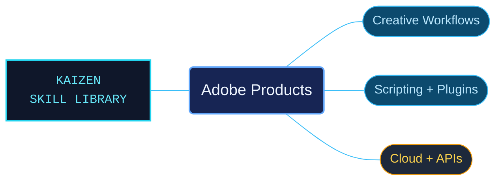

# Adobe Products

A coordinated library of Adobe product references for creative work, automation and integration. Product reference indexes keep desktop workflows, scripting environments, plug-in APIs and cloud services in their proper host and version context.

Use when a task needs Adobe product documentation, workflows, scripting, plugins, SDKs or service APIs for Acrobat, Photoshop, Illustrator, InDesign, InCopy, Premiere Pro, After Effects, Audition, Media Encoder, Firefly, or shared CEP, ExtendScript and ScriptUI. Not for other creative software or generic image or PDF tasks without an Adobe product.

## What this skill helps with

| Task | Useful reference material |
| --- | --- |
| [Work on documents and layouts](references/acrobat/INDEX.md) | Start with PDF workflows, then select the InDesign or InCopy reference area for publishing work. |
| [Create and automate artwork](references/photoshop/INDEX.md) | Use Photoshop references or select Illustrator and Firefly for their distinct workflows and APIs. |
| [Edit moving images and sound](references/premiere-pro/INDEX.md) | Navigate Premiere Pro alongside dedicated After Effects, Audition and Media Encoder material. |
| [Develop Adobe integrations](references/common-platform/INDEX.md) | Consult shared ExtendScript, ScriptUI and CEP material, retaining each product API's separate conditions. |

## Included product and platform references

| Product area | Use it for |
| --- | --- |
| [Acrobat](references/acrobat/INDEX.md) | PDF workflows, JavaScript and document service integrations. |
| [After Effects](references/after-effects/INDEX.md) | Compositing, animation, expressions, scripting and native plug-in APIs. |
| [Audition](references/audition/INDEX.md) | Recording, audio editing, restoration, analysis and mixing. |
| [Shared Adobe platform](references/common-platform/INDEX.md) | ExtendScript, ScriptUI, BridgeTalk, CEP and attributed community declarations. |
| [Firefly](references/firefly/INDEX.md) | Generative media workflows, enterprise features and service APIs. |
| [Illustrator](references/illustrator/INDEX.md) | Vector artwork, typography, scripting and cloud automation. |
| [InCopy](references/incopy/INDEX.md) | Editorial stories, assignments, collaboration and publishing content. |
| [InDesign](references/indesign/INDEX.md) | Page layout, publishing, DOM automation and UXP development. |
| [Media Encoder](references/media-encoder/INDEX.md) | Encoding queues, presets, formats, export and scripting. |
| [Photoshop](references/photoshop/INDEX.md) | Image workflows, UXP development and cloud-service APIs. |
| [Premiere Pro](references/premiere-pro/INDEX.md) | Editing, media workflows, audio, export, scripting and UXP. |

## The work behind the references

Desktop help and developer material are interpreted into product-owned reference trees, with focused catalogs and descriptive filenames. Source review and repair addressed identified code, literal, prerequisite and routing defects while preserving API identifiers, host conditions and source-specific notices.

## Start here

Start with [SKILL.md](SKILL.md) and follow its context routes.

Keep the complete product bundle together. Select the product reference index before using an example, and preserve its host, platform, runtime and version requirements. Desktop scripting, UXP and cloud APIs can expose different operations even within one product.

## Sources and license

Skill reference documentation is interpreted content for use in open source projects. Check against [official documentation sources](https://developer.adobe.com/) when dealing with defects or issues that may come up from interpreting this skill's references.

Licensed under **Apache-2.0**; see [LICENSE](LICENSE). Part of the [Agent Kaizen](https://github.com/LevyBytes/agent-kaizen) skill library.
