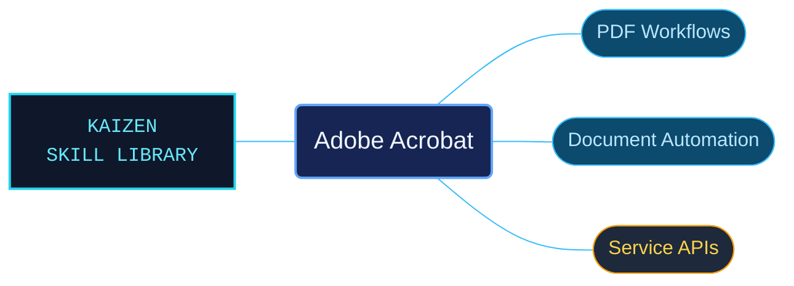

# Adobe Acrobat

Adobe Acrobat references for document workflows, PDF automation and application integration. Desktop, web and mobile tasks have separate routes from JavaScript and document-service APIs, keeping the relevant product surface explicit.

Use when creating, editing, reviewing, signing, securing, or troubleshooting PDFs in Adobe Acrobat desktop, web, or Reader; automating Acrobat with JavaScript; or integrating Adobe PDF Services, Document Generation, PDF Extract, PDF Embed, or electronic seals. Includes forms, accessibility, printing, and Acrobat AI workflows.

## What this skill helps with

| Task | Useful reference material |
| --- | --- |
| [Work with PDFs](references/desktop/reference-index.md) | Find editing, forms, review, signing, accessibility and other desktop workflows. |
| [Automate Acrobat](references/scripting/reference-index.md) | Look up the scripting interfaces used by Acrobat automation. |
| [Integrate PDF services](references/pdf-services/reference-index.md) | Navigate PDF Services API contracts and related examples. |

## The work behind the references

Product help and developer material are organized by workflow and API surface, preserving host and version conditions alongside the interpreted prose.

## Start here

Start with [SKILL.md](SKILL.md) and follow its context routes.

Select desktop, web, mobile or service behavior before adapting an example. The context router also links Document Generation, PDF Embed, application integrations and AI workflows.

## Sources and license

Skill reference documentation is interpreted content for use in open source projects. Check against [official documentation sources](https://helpx.adobe.com/acrobat.html) when dealing with defects or issues that may come up from interpreting this skill's references.

Licensed under **AGPL-3.0**; see [LICENSE](../LICENSE). Part of the [Agent Kaizen](https://github.com/LevyBytes/agent-kaizen) skill library.
