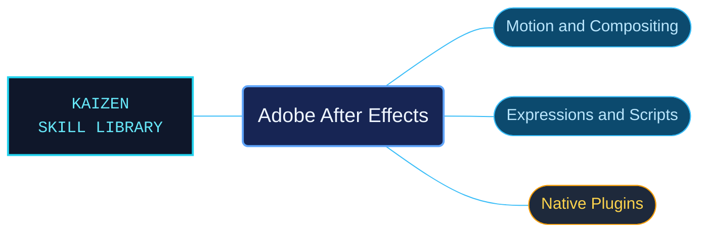

# Adobe After Effects

After Effects references for compositing, animation and extensibility. Creative workflows, scripting objects and native plug-in contracts have distinct entrypoints so the agent can choose the appropriate level of detail.

Use when working in Adobe After Effects with compositions, footage, layers, text, shapes, animation, tracking, keying, effects, color, 3D, previews, rendering, expressions, ExtendScript automation, or C++ effect and AEGP plugins. Routes to bundled desktop help, scripting object references, and SDK contracts with their original version limits.

## What this skill helps with

| Task | Useful reference material |
| --- | --- |
| [Create and animate compositions](references/desktop/reference-index.md) | Find layers, effects, tracking, color, previews and rendering workflows. |
| [Automate project work](references/scripting/reference-index.md) | Look up scripting objects and their documented behavior. |
| [Develop native plug-ins](references/plugin-sdk/reference-index.md) | Navigate effect and AEGP SDK contracts. |

## The work behind the references

Desktop help, scripting references and SDK documentation are separated by their host interface while preserving version-specific details and technical identifiers.

## Start here

Start with [SKILL.md](SKILL.md) and follow its context routes.

Keep expression, ExtendScript and C++ SDK requirements distinct. Use the runtime and host version named by the selected reference.

## Sources and license

Skill reference documentation is interpreted content for use in open source projects. Check against [official documentation sources](https://helpx.adobe.com/after-effects.html) when dealing with defects or issues that may come up from interpreting this skill's references.

Licensed under **AGPL-3.0**; see [LICENSE](../LICENSE). Part of the [Agent Kaizen](https://github.com/LevyBytes/agent-kaizen) skill library.
