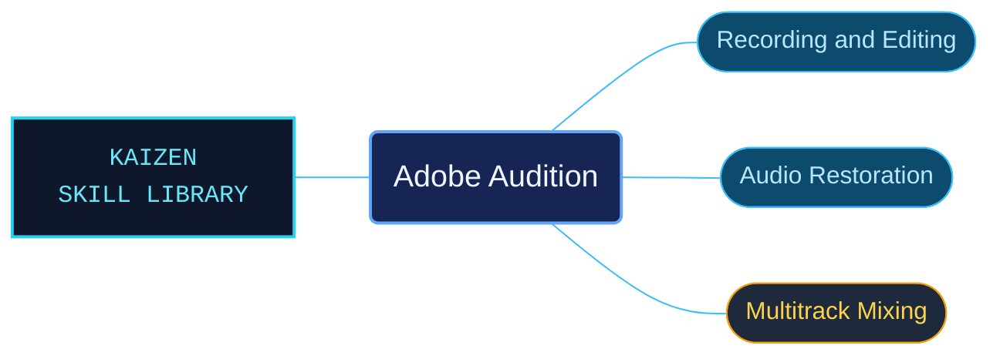

# Adobe Audition

Adobe Audition references for recording, editing, restoring and mixing audio. The material connects Waveform and Multitrack work with analysis, effects and export guidance for production tasks.

Use when a task concerns Adobe Audition audio recording, Waveform editing, Multitrack mixing, restoration, effects, audio analysis, podcast production, surround sound, or saving and exporting audio.

## What this skill helps with

| Task | Useful reference material |
| --- | --- |
| [Find an audio workflow](references/desktop/reference-index.md) | Select recording, editing, restoration, analysis, mixing or export material. |
| [Browse the product reference](references/INDEX.md) | Navigate the bundled Audition subjects and their documented controls. |

## The work behind the references

Audio workflows are organized into focused references that retain control names, modes and procedure conditions.

## Start here

Start with [SKILL.md](SKILL.md) and follow its context routes.

Select the editing mode and audio workflow before following a procedure. Preserve its documented version, channel and output-format conditions.

## Sources and license

Skill reference documentation is interpreted content for use in open source projects. Check against [official documentation sources](https://helpx.adobe.com/audition.html) when dealing with defects or issues that may come up from interpreting this skill's references.

Licensed under **Apache-2.0**; see [LICENSE](../LICENSE). Part of the [Agent Kaizen](https://github.com/LevyBytes/agent-kaizen) skill library.
