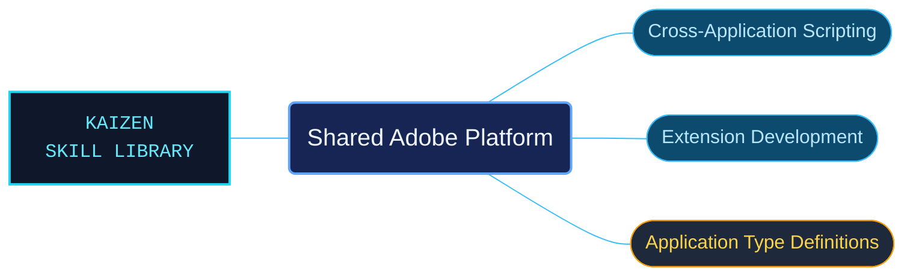

# Shared Adobe Platform

Shared Adobe developer references for scripting across applications and building CEP integrations. The package separates Adobe runtime interfaces from community application declarations and identifies the context each belongs to.

Use when a task concerns Adobe shared developer-platform APIs: ExtendScript, ScriptUI, BridgeTalk, Socket, ExternalObject, XMPScript, CEP extensions and version-specific runtimes, CEP-to-UXP migration, or bundled community Adobe application type declarations.

## What this skill helps with

| Task | Useful reference material |
| --- | --- |
| [Build CEP integrations](references/cep/reference-index.md) | Find CEP setup, runtime, debugging and ExtendScript integration material. |
| [Use shared scripting APIs](references/scripting/reference-index.md) | Look up ExtendScript, ScriptUI and related platform interfaces. |
| [Consult application declarations](references/community-types/reference-index.md) | Inspect the attributed community type declarations. |

## The work behind the references

Shared APIs, CEP runtime documentation and community declarations have separate routes so their provenance and compatibility conditions remain visible.

## Start here

Start with [SKILL.md](SKILL.md) and follow its context routes.

Match the host application and runtime version to the selected API. Community declarations are separately attributed; they do not establish host behavior by themselves.

## Sources and license

Skill reference documentation is interpreted content for use in open source projects. Check against [official documentation sources](https://github.com/Adobe-CEP/CEP-Resources) when dealing with defects or issues that may come up from interpreting this skill's references.

Licensed under **Apache-2.0**; see [LICENSE](../LICENSE). Part of the [Agent Kaizen](https://github.com/LevyBytes/agent-kaizen) skill library.
