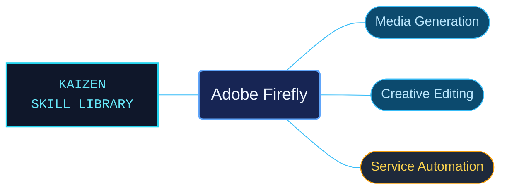

# Adobe Firefly

Adobe Firefly references for generative media workflows and service integration. Web and mobile product guidance is kept separate from cloud API contracts and example modules.

Use when working with Adobe Firefly image, vector, audio, or video generation and editing; Boards and video editor; custom models, enterprise Creative Production, Graph, and brand workflows; or Firefly Services image-generation, compositing, upscale, and asynchronous REST API guides.

## What this skill helps with

| Task | Useful reference material |
| --- | --- |
| [Use Firefly workflows](references/web/reference-index.md) | Find generation, editing and creative-production guidance. |
| [Call Firefly services](references/cloud-services/reference-index.md) | Navigate the bundled cloud API contracts. |
| [Inspect API examples](references/api-examples/reference-index.md) | Follow the example modules with their linked dependencies and setup. |

## The work behind the references

Product features and service APIs are organized by surface, with request contracts and version conditions retained around the examples.

## Start here

Start with [SKILL.md](SKILL.md) and follow its context routes.

Check the product surface, account availability and API version named in each reference. Web features and service APIs can expose different workflows.

## Sources and license

Skill reference documentation is interpreted content for use in open source projects. Check against [official documentation sources](https://helpx.adobe.com/firefly.html) when dealing with defects or issues that may come up from interpreting this skill's references.

Licensed under **Apache-2.0**; see [LICENSE](../LICENSE). Part of the [Agent Kaizen](https://github.com/LevyBytes/agent-kaizen) skill library.
