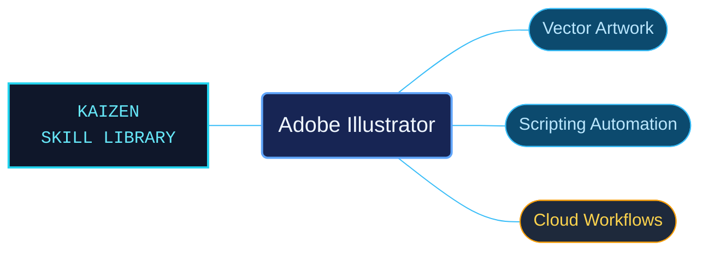

# Adobe Illustrator

Adobe Illustrator references for vector artwork, document production and automation. Desktop workflows, language-specific scripting and cloud services have separate routes for choosing the correct interface.

Use when creating or editing vector artwork in Adobe Illustrator: paths, shapes, typography, color, artboards, layers, effects, generative artwork, saving and export; automating Illustrator through JavaScript, AppleScript, or VBScript; or integrating Illustrator Custom Scripts, Image Trace, and Data Merge cloud APIs.

## What this skill helps with

| Task | Useful reference material |
| --- | --- |
| [Create and prepare artwork](references/desktop/reference-index.md) | Find paths, typography, color, artboards, effects and export workflows. |
| [Automate Illustrator](references/scripting/reference-index.md) | Look up JavaScript, AppleScript and VBScript scripting material. |
| [Use cloud automation](references/cloud-services/reference-index.md) | Find Custom Scripts, Image Trace and Data Merge API guidance. |

## The work behind the references

Artwork help and developer contracts are interpreted into product-owned topics, preserving platform and language distinctions around exact identifiers.

## Start here

Start with [SKILL.md](SKILL.md) and follow its context routes.

Select the desktop scripting language or cloud API before adapting an example. Keep its application, platform and service-version conditions.

## Sources and license

Skill reference documentation is interpreted content for use in open source projects. Check against [official documentation sources](https://helpx.adobe.com/illustrator.html) when dealing with defects or issues that may come up from interpreting this skill's references.

Licensed under **AGPL-3.0**; see [LICENSE](../LICENSE). Part of the [Agent Kaizen](https://github.com/LevyBytes/agent-kaizen) skill library.
