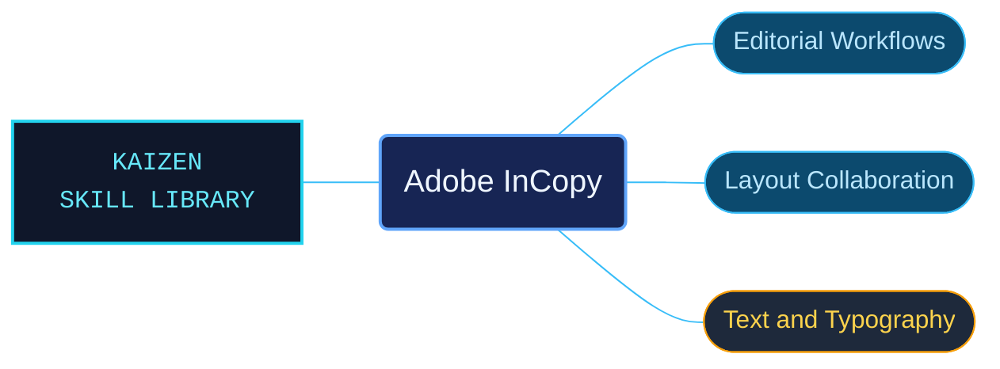

# Adobe InCopy

Adobe InCopy references for editorial work within a publishing workflow. The material connects managed stories and assignments with copy editing, collaboration, typography and document exchange.

Use when a task concerns Adobe InCopy editorial work: managed stories and assignments, InDesign collaboration, copy editing, tracked changes and notes, typography and CJK text, tables, placed graphics, references and links, XML, or document export and printing.

## What this skill helps with

| Task | Useful reference material |
| --- | --- |
| [Find an editorial workflow](references/desktop/reference-index.md) | Locate stories, assignments, tracked changes, text, tables and export guidance. |
| [Browse product subjects](references/INDEX.md) | Navigate the bundled InCopy references and their documented controls. |

## The work behind the references

Editorial subjects are organized into focused documents while retaining the collaboration and managed-content conditions attached to each procedure.

## Start here

Start with [SKILL.md](SKILL.md) and follow its context routes.

Match the document and assignment context before applying a workflow. Preserve the documented InDesign collaboration and version requirements.

## Sources and license

Skill reference documentation is interpreted content for use in open source projects. Check against [official documentation sources](https://helpx.adobe.com/incopy.html) when dealing with defects or issues that may come up from interpreting this skill's references.

Licensed under **Apache-2.0**; see [LICENSE](../LICENSE). Part of the [Agent Kaizen](https://github.com/LevyBytes/agent-kaizen) skill library.
