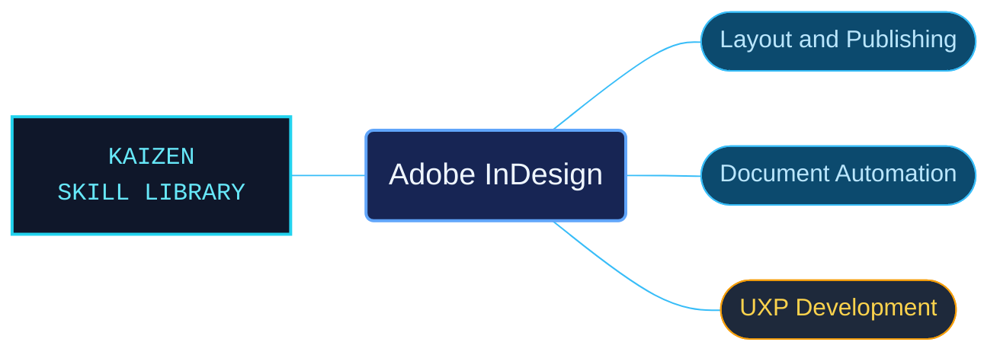

# Adobe InDesign

Adobe InDesign references for page layout, publishing and programmable document workflows. Desktop procedures, the document object model and UXP development are separated so each task reaches the appropriate contract.

Use when working with Adobe InDesign page layout, documents and books, typography, graphics, tables, interactive documents, collaboration, publishing, printing, preflight, or troubleshooting; automating the InDesign DOM; or building InDesign UXP scripts and plugins with the bundled runtime, UI, storage, and recipe references.

## What this skill helps with

| Task | Useful reference material |
| --- | --- |
| [Design and publish documents](references/desktop/reference-index.md) | Find layout, typography, graphics, books, preflight and output workflows. |
| [Automate the document model](references/document-model/reference-index.md) | Look up the InDesign DOM and its document operations. |
| [Develop UXP integrations](references/uxp/reference-index.md) | Find scripts, plug-ins, runtime APIs and recipes. |

## The work behind the references

Product help and developer references retain their interface ownership, with separate routes for document objects and UXP runtime behavior.

## Start here

Start with [SKILL.md](SKILL.md) and follow its context routes.

Use the host and runtime version required by the selected example. A document-model operation and a UXP runtime service may have different conditions.

## Sources and license

Skill reference documentation is interpreted content for use in open source projects. Check against [official documentation sources](https://helpx.adobe.com/indesign.html) when dealing with defects or issues that may come up from interpreting this skill's references.

Licensed under **AGPL-3.0**; see [LICENSE](../LICENSE). Part of the [Agent Kaizen](https://github.com/LevyBytes/agent-kaizen) skill library.
