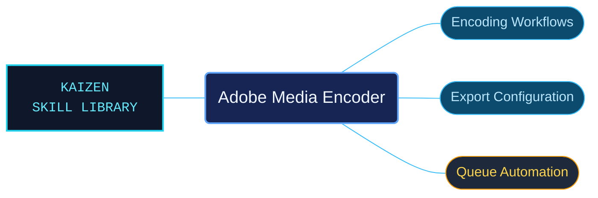

# Adobe Media Encoder

Adobe Media Encoder references for managing encoding jobs and automating delivery workflows. Desktop controls, scripting objects and automation examples are grouped separately to connect queue operations with their configuration.

Use when working with Adobe Media Encoder queues, presets, ingest and watch folders, media formats, encoding and export settings, publishing destinations, audio channelization, loudness, preferences, or media cache; or automating AME with ExtendScript encoder, exporter, frontend, event, and watch-folder objects.

## What this skill helps with

| Task | Useful reference material |
| --- | --- |
| [Configure encoding and export](references/desktop/reference-index.md) | Find queues, presets, formats, watch folders and publishing settings. |
| [Use the scripting interfaces](references/scripting/reference-index.md) | Look up encoder, exporter, frontend, event and watch-folder objects. |
| [Adapt automation examples](references/automation/reference-index.md) | Follow workflow examples with their supporting setup. |

## The work behind the references

Queue and export procedures are organized alongside separately routed API contracts, preserving event and host conditions around automation examples.

## Start here

Start with [SKILL.md](SKILL.md) and follow its context routes.

Match the installed Media Encoder version and the required media formats. Read the selected example's queue and event prerequisites before adapting it.

## Sources and license

Skill reference documentation is interpreted content for use in open source projects. Check against [official documentation sources](https://helpx.adobe.com/media-encoder.html) when dealing with defects or issues that may come up from interpreting this skill's references.

Licensed under **AGPL-3.0**; see [LICENSE](../LICENSE). Part of the [Agent Kaizen](https://github.com/LevyBytes/agent-kaizen) skill library.
