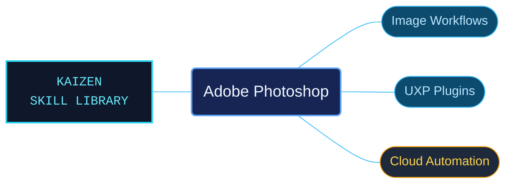

# Adobe Photoshop

Adobe Photoshop references for image work and programmable integrations. Desktop editing, UXP plug-ins and cloud APIs have distinct entrypoints that retain their different execution models and capabilities.

Use when working with Adobe Photoshop desktop images, layers, selections, masks, color, typography, filters, automation and export; developing Photoshop UXP plugins with the object model, batchPlay, executeAsModal, imaging, storage, UI and XMP APIs; or integrating Photoshop cloud APIs and their versioned migration contracts. Keep Photoshop UXP, legacy scripting, and cloud-service behavior distinct.

## What this skill helps with

| Task | Useful reference material |
| --- | --- |
| [Work on images and documents](references/desktop/reference-index.md) | Find layers, selections, masks, color, typography, filters and output workflows. |
| [Develop UXP plug-ins](references/uxp/reference-index.md) | Navigate the object model, batchPlay, modal execution, imaging and runtime APIs. |
| [Integrate cloud services](references/cloud-services/reference-index.md) | Check cloud operations and versioned migration contracts. |

## The work behind the references

Creative help and developer interfaces are organized into separate topic trees, with exact API identifiers and host requirements retained around the prose and examples.

## Start here

Start with [SKILL.md](SKILL.md) and follow its context routes.

Keep Photoshop desktop, legacy scripting, UXP and cloud-service behavior distinct. Use [plug-in examples](references/plugin-samples/reference-index.md) with their documented runtime and setup.

## Sources and license

Skill reference documentation is interpreted content for use in open source projects. Check against [official documentation sources](https://helpx.adobe.com/photoshop.html) when dealing with defects or issues that may come up from interpreting this skill's references.

Licensed under **AGPL-3.0**; see [LICENSE](../LICENSE). Part of the [Agent Kaizen](https://github.com/LevyBytes/agent-kaizen) skill library.
