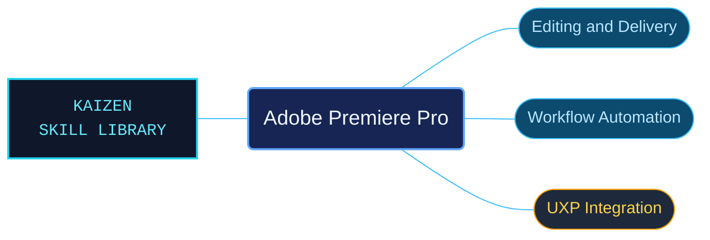

# Adobe Premiere Pro

Adobe Premiere Pro references for editing workflows and application extensibility. Media, timeline, audio and delivery guidance is routed separately from scripting APIs and UXP plug-in development.

Use when a task concerns Adobe Premiere Pro editing, timelines, media and proxies, text-based editing, graphics and captions, audio mixing, effects, masks, color management and grading, export, collaboration, troubleshooting, ExtendScript, Premiere UXP classes, or UXP plug-in development and runtime APIs. Preserve each reference's host, platform, and version conditions.

## What this skill helps with

| Task | Useful reference material |
| --- | --- |
| [Edit and deliver a program](references/desktop/reference-index.md) | Find media, timelines, captions, effects, audio, collaboration and export workflows. |
| [Automate Premiere Pro](references/scripting/reference-index.md) | Look up the documented scripting interfaces. |
| [Build UXP integrations](references/uxp/reference-index.md) | Navigate UXP classes, development guidance and runtime APIs. |

## The work behind the references

Editing procedures, scripting contracts and plug-in references have distinct routes, preserving host, version and platform conditions for the selected surface.

## Start here

Start with [SKILL.md](SKILL.md) and follow its context routes.

Select the interface supported by the target Premiere Pro version. Read [plug-in examples](references/plugin-samples/reference-index.md) with their linked dependencies and runtime conditions.

## Sources and license

Skill reference documentation is interpreted content for use in open source projects. Check against [official documentation sources](https://helpx.adobe.com/premiere-pro.html) when dealing with defects or issues that may come up from interpreting this skill's references.

Licensed under **AGPL-3.0**; see [LICENSE](../LICENSE). Part of the [Agent Kaizen](https://github.com/LevyBytes/agent-kaizen) skill library.
